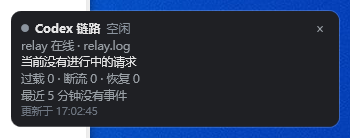

# Codex 链路监控（DSH 插件）

在 DeepSeek Harness 里常驻一个置顶小窗，实时显示你的 Codex 现在是在跑任务、还是卡在过载重试 / 断流重连；
以及这次请求服务端到底给了哪个模型。



## 它能看出什么

- **任务是否在跑**：请求发出到流结束之间算「运行中」，结束后最多 5 秒回到「空闲」。
- **过载 / 断流**：`server_is_overloaded`、`http 429/5xx` 记为过载；`connect/read error`、`stream error`、`stream ended early` 记为断流重连。
- **模型有没有被换**：把请求头里的 `model=` 和服务端 `response.created` 里的 `model` 对比，不一致时整行变红并在计数里累计。
- **Codex 自己的重连**：`tpp-local-executor` 的 reconnect episode、`app_server_connection` 的 `reconnectAttempt`。

## 工作原理

```
Codex ──> 127.0.0.1:8787 relay ──> 上游
                 │ 写 relay.log
                 ▼
        ┌──────────────────┐      GET /codex-relay/status      ┌──────────────┐
        │ DSH Host 插件     │ ────────────────────────────────> │ widget.ps1   │
        │ tail 两份日志     │                                  │ 2s 轮询 / WPF │
        └──────────────────┘ <──────────────────────────────── └──────────────┘
                 ▲
                 │ tail
        %LOCALAPPDATA%\Codex\Logs\<年>\<月>\<日>\*.log
```

- **Host 半身**（`index.js`）：增量 tail `relay.log` 和 Codex 桌面日志，维护每个请求的状态，注册 `GET /codex-relay/status` 返回 JSON 快照。
- **Client 半身**（`client.js`）：空实现。界面不在 Harness 页面里，避免遮挡对话。
- **小窗**（`widget.ps1` + `launch-widget.vbs`）：WPF 置顶窗口，每 2 秒拉一次接口；拖动标题区移动，右上角 `×` 关闭。插件启用时启动，停用/退出时按 PID 关掉。
  监听端口每次启动都可能变，插件会把当前地址写进 `%TEMP%\codex-relay-widget.url`，小窗启动时读它，不写死端口。

## 安装

1. 克隆或下载本仓库到本地，例如 `D:\tools\dsh-codex-relay-monitor`。
2. 用 DSH 的 `plugin_manager` 把它装成 bundle：

   ```
   plugin_manager install_bundle  target: <仓库绝对路径>
   ```

   也可以手工把它写成一条 `cordis.patch.yml` 的 row（包名 `@local/codex-relay-monitor`）。
3. 装完小窗会自动出现在屏幕右侧；Harness 页面不需要刷新（页面里本来就没有 UI）。

## 依赖

- **Windows**：小窗是 WPF + Windows PowerShell 5.1（`widget.ps1` 必须带 UTF-8 BOM）。
- **DeepSeek Harness**：使用了 `ctx.webServer.register` 与 `dsh.bundle` / `dsh.client` 清单。
- **codex-overload-fix**（推荐）：默认从 `%USERPROFILE%\.codex-overload-fix\relay.log` 读 relay 日志。

## 配置

在 patch 行里给插件加 `config`，全部可选：

```yaml
- insert:
    - id: codex-relay-monitor
      name: '@local/codex-relay-monitor'
      config:
        relayLog: 'C:\Users\me\.codex-overload-fix\relay.log'
        codexLogRoot: 'C:\Users\me\AppData\Local\Codex\Logs'
        relayPort: 8787
        pollMs: 1500
        widget: true
```

## 识别哪些日志行

relay（`relay.py`）：

```
2026-11-05 16:12:31 [14959] POST /responses (97856B) | model=gpt-6.1-sol effort=medium ...
2026-11-05 16:12:43 [14959] attempt 1: retryable (error event overload: server_is_overloaded)
2026-11-05 16:13:46 [14959] attempt 4: ok, streaming (served=gpt-6.1-sol)
2026-11-05 16:14:20 [14959] stream finished in 34.0s
```

Codex 桌面日志：

```
... [tpp-local-executor] Local Work executor connection observation ... event=episode_started phase=reconnect
... [AppServerConnection] app_server_connection.state_changed ... reconnectAttempt=2 ...
```

## 让 relay 补两处日志（推荐）

上游 `relay.py` 默认不记录「服务端实际模型」和「流什么时候结束」。不打这两个补丁也能跑，
但「换模型检测」会失效、「任务结束」只能退化成 3 分钟静默判定。改动只有两处：

```python
# attempt()：把服务端在 response.created 里报的模型记下来
_served = (_ev.get("response") or {}).get("model") if _ev else None
if _served:
    observed["served"] = _served
    _tag = f"[served={_served}] [from={cport}] "
```

```python
# _proxy()：成功行带上 served，并在流真正结束时补一行
log(f"[{cport}] attempt {attempt_no}: ok, streaming"
    + (f" (served={served})" if served else ""))
stream_started = time.time()
try:
    self._stream_back(resp_headers, prelude, conn, resp)
finally:
    log(f"[{cport}] stream finished in {time.time() - stream_started:.1f}s")
```

## 已知限制

- 一次只显示最新的一条请求；多会话并发时其余请求只计入计数。
- `running` 依赖 relay 的结束行；没有结束行时，3 分钟无新日志即判空闲。
- 小窗位置不记忆，每次启动回到右侧默认位置；DSH 崩溃时小窗会残留（显示「接口未连接」）。
- 只读本机日志与本地端口，不联网、不解析对话内容。

## License

MIT

---

## English

A tiny always-on-top widget for [DeepSeek Harness](https://github.com/deepseek-ai/deepseek-harness) that shows what your
local [Codex](https://openai.com/codex) is doing: the in-flight request (model, body size, attempt, elapsed), overload
retries and dropped streams in the last five minutes, and whether the server actually served the model you asked for.

The Host half tails `relay.log` from [codex-overload-fix](https://github.com/NewBeeM4n/codex-overload-fix) and the Codex
desktop logs, then serves one JSON snapshot at `GET /codex-relay/status`. The widget is a WPF window that polls it every
two seconds, so nothing is drawn inside the Harness page. Windows only for the widget; the Host half is plain Node.
